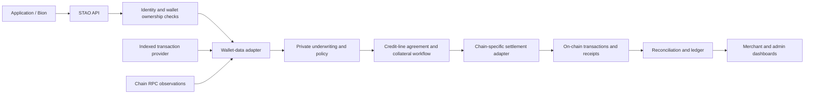

# Architecture

STAO separates evidence collection, credit decisions and funds movement. The public example covers one read-only evidence input.

The diagram describes system responsibilities, not proof that every component is deployed on Arbitrum. Identity details remain within the authorized application and backend; they are not placed on-chain by this design.

## Responsibility boundaries

| Component | Responsibility |
| --- | --- |
| Application | Present the application, verification, agreement, collateral and repayment journey |
| Data adapters | Retrieve evidence and preserve its chain, token and checkpoint identity |
| STAO decision layer | Apply underwriting and merchant policy; keep the decision separate from raw provider output |
| Settlement adapter | Build or execute authorized chain-specific operations; it does not determine eligibility |
| Reconciliation and ledger | Match confirmed events to obligations and prevent duplicate accounting |
| Dashboards | Show operational state and authorized controls |

For EVM wallet analysis, indexed provider data and direct RPC observations have different roles. Indexed data supplies history; RPC reads supply an independent current-state observation. Neither a token symbol nor a successful HTTP response establishes that a balance is eligible for lending.

## Public example boundary

`src/arbitrum-usdc.mjs` reads native USDC on Arbitrum One. It identifies one token by its contract, checks its decimals, and attaches block evidence to the observed balance. It deliberately has no underwriting weights, transaction-history logic, customer database, signing component, or transfer method.

Read-only RPC access is not borrower authentication. A production integration also needs verified wallet ownership, complete history, reconciliation, access controls and chain-specific settlement safeguards.
